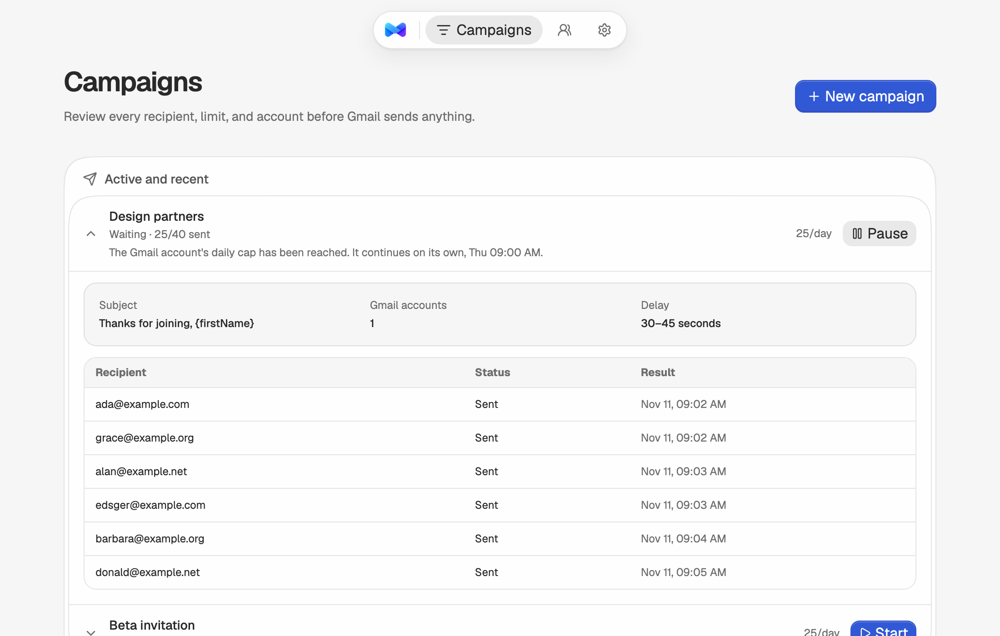

# TinyMails

**A Gmail outbox for your agent.** TinyMails runs on your computer. Your AI agent queues a small email campaign over MCP, you read the test and press Start, and Gmail sends it one message at a time under a daily cap.

It is open source, has no cloud service, and keeps contacts, templates, sending history, and Google credentials on your machine.



Website: [tinymails.vercel.app](https://tinymails.vercel.app) · Guide for agents: [agent-guide.md](site/public/agent-guide.md)

## How it works

1. **Your agent queues it.** Over [MCP](#connect-an-agent), an agent on the same computer creates the campaign. It always arrives paused, and TinyMails reports every address it refused.
2. **You get the test.** The real, personalized email lands in your own inbox. Nothing has gone to a recipient.
3. **You press Start.** Agents cannot start a send unless you switch that on in Settings.
4. **The queue paces itself.** One message at a time, random delays, inside your sending hours, up to your daily cap. At the cap it waits and carries on the next day.

You can also do all of it yourself in the TinyMails window, without an agent.

## What it does

- Lets an agent queue, test, check, and pause campaigns over MCP. Starting a send stays with you unless you switch that on.
- Enforces account caps, sending windows, and delays at the Gmail boundary.
- Waits at the daily cap or outside the sending window, then continues by itself while TinyMails is running.
- Sends the personalized campaign copy to each assigned Gmail account for approval before Start becomes available.
- Excludes duplicates, suppressed addresses, and contacts already queued elsewhere.
- Persists campaign state after each send and flags interrupted deliveries for manual review.
- Connects a user-owned Google Desktop OAuth client with send-only access, and stores Google tokens in the operating-system credential vault.
- Imports contacts from reviewed CSV files, keeps each contact unique by email across lists, and derives contact status from campaign history and the do-not-contact list.
- Saves reusable templates and exports a portable backup without credential metadata or tokens.
- Keeps Gmail access behind an adapter with no network calls in tests.

TinyMails does not insert tracking pixels, host contact data, write email copy with AI, automate follow-ups, read the inbox, detect replies or bounces, send HTML email, restore backup files, or provide a managed OAuth application. Agents that run in the cloud cannot reach it.

## Requirements

- Node.js 22 or newer
- npm 10 or newer

Gmail support requires a Google Cloud project and Desktop OAuth client that you control. TinyMails asks only for basic identity and `gmail.send`; it does not request inbox access.

On Linux, the native credential vault needs a Secret Service-compatible keyring available in the user session. macOS uses Keychain and Windows uses Credential Manager.

## Run it locally

```bash
git clone https://github.com/Gauthi3r/tinymails.git
cd tinymails
npm install
npm start
```

`npm start` builds the app, starts it only on `127.0.0.1`, and opens `http://127.0.0.1:3210`. Set `TINYMAILS_NO_OPEN=1` if you do not want it to open a browser.

A campaign you started keeps going for as long as TinyMails is running: at the daily cap or outside the sending window it shows **Waiting** and continues by itself at the next allowed time. If TinyMails is stopped and started again, a campaign that was running comes back paused and tells you so. Press **Start** to continue.

The daily cap counts per calendar day in the account's time zone. If your sending hours cross midnight, a waiting campaign continues at midnight, so keep the cap well below Gmail's own rolling 24-hour limit.

Only one TinyMails process may use a data directory, even when processes use different ports. A second process exits before campaign recovery or sending begins. Normal shutdown removes `instance.lock`. If TinyMails reports a stale lock after a crash or power loss, first confirm that no TinyMails process is running, then remove `instance.lock` from the data directory shown in the error.

## Connect Gmail

TinyMails does not ship a shared OAuth client. Each user creates one in a Google Cloud project they control:

1. Open [Google Cloud Console](https://console.cloud.google.com/) and create or choose a project.
2. Configure the [Google Auth Platform](https://console.cloud.google.com/auth/overview). For an External app in Testing mode, add the Gmail address you will connect as a test user. Internal apps are available only to eligible Google Workspace organizations.
3. Enable the [Gmail API](https://console.cloud.google.com/apis/library/gmail.googleapis.com).
4. Open [Clients](https://console.cloud.google.com/auth/clients), create an OAuth client with application type **Desktop app**, and download its JSON file.
5. Start TinyMails, open **Settings**, choose that JSON file, and finish consent in the Google window.
6. Create a campaign and use **Send test** on its review step. TinyMails sends the personalized preview to each assigned Gmail address. **Start** unlocks once every preview succeeds, and pressing it begins sending immediately.

Google can show an unverified-app notice for a personal Testing configuration. Testing-mode authorization for an External app may also expire after seven days, requiring a reconnect. Publishing and verifying a shared OAuth app is a separate distribution step; bring-your-own OAuth does not bypass Google's consent or user rules.

Client metadata stays under the local TinyMails data directory with user-only permissions. The refresh token goes to the operating-system credential vault. Short-lived access credentials stay in process memory and disappear when TinyMails stops. None of this data is uploaded to a TinyMails service.

Settings can disconnect a Gmail account and remove its local OAuth client and token. To revoke the grant at Google as well, remove TinyMails from your [Google Account connections](https://myaccount.google.com/connections).

## Connect an agent

TinyMails serves an [MCP](https://modelcontextprotocol.io) endpoint while it is running. An agent on the same computer can use it to prepare a send for you.

Add this address to your agent as an MCP server (Streamable HTTP):

```text
http://127.0.0.1:3210/mcp
```

In Claude Code, for example:

```bash
claude mcp add --transport http tinymails http://127.0.0.1:3210/mcp
```

For an agent that starts a command instead of opening an address, use the stdio bridge. It holds no data of its own and talks to the TinyMails that is already running:

```json
{
  "mcpServers": {
    "tinymails": {
      "command": "node",
      "args": ["/absolute/path/to/tinymails/scripts/mcp.mjs"]
    }
  }
}
```

Settings shows both values with the real port and path, ready to copy.

| Tool | What it does |
| --- | --- |
| `list_accounts` | Connected Gmail accounts with their daily cap, delays, time zone, and sending hours. |
| `queue_campaign` | Creates a campaign. It always arrives paused, and the answer lists every address TinyMails refused. |
| `send_test` | Sends the real, personalized email to your own Gmail address. Nothing goes to a recipient. |
| `get_campaigns` | Progress, why a campaign is paused or waiting, and when it resumes. |
| `pause_campaign` | Pauses a running campaign. |
| `add_do_not_contact` | Adds addresses that must never be emailed. |

There is no start tool. You read the test and press **Start** in TinyMails. If you want an agent to start campaigns too, turn on **Let agents start campaigns** in Settings: a `start_campaign` tool then appears, and it still needs the campaign's test to have been sent. An agent connected through the stdio bridge sees it after reconnecting.

What this boundary is and is not:

- The endpoint answers only on `127.0.0.1` and `localhost`, and it rejects requests from other websites. An agent running in the cloud cannot reach it.
- The MCP tools are a thin layer over the same local API the screens use (`src/mcp/`), so caps, sending hours, suppression, and the test-before-start rule apply to agents exactly as they do to you.
- "No start tool" is a rule of the MCP connection. An agent that can also run commands on your computer can call the local API directly, like any other program you run. Give shell access only to agents you would trust with the Start button.

## Develop

For UI development, run the API and Vite in separate terminals:

```bash
npm run serve
npm run dev
```

Vite runs at `http://127.0.0.1:5173` and proxies `/api` requests to the local service.

## Distribution

TinyMails is source-first: clone → `npm install` → `npm start`. This keeps the local data model, operating-system credential vault, loopback OAuth callback, and background campaign runner intact without installer signing or a hosted control plane.

TinyMails keeps its own Gmail identity: the MCP endpoint lets an agent drive TinyMails, and TinyMails sends through the Google OAuth grant you gave it. A managed TinyMails OAuth client and signed desktop installers are later distribution projects if the source release earns regular users.

Do not expose port 3210 to a public interface or deploy this loopback server as a multi-user web app.

## Local data

TinyMails stores runtime data in `~/.tinymails` by default. Set `TINYMAILS_DATA_DIR` to use another directory:

```bash
TINYMAILS_DATA_DIR=/path/to/tinymails-data npm run serve
```

Do not point this at the source checkout. The public-tree scanner rejects credential files, token-shaped values, logs, root CSV files, and non-example email addresses.

Do not share one data directory between simultaneous TinyMails processes. The exclusive `instance.lock` file enforces this boundary for both `npm start` and `npm run serve`.

Use the Leads page to delete selected contacts from the contact library and unsent queues. Completed delivery history remains as an audit record. To erase all TinyMails contacts, campaigns, templates, and suppression data, stop the app and remove the data directory shown in Settings. Disconnect each Gmail account first so its token is also removed from the operating-system credential vault. TinyMails does not yet provide backup restore.

## Checks

```bash
npm run scan
npm run lint
npm test -- --run
npm run build
```

Run all four with `npm run check`.

## Responsible use

Only contact people who expect to hear from you. Keep lists small, honor removal requests, and stay within Gmail's policies and applicable law. TinyMails includes caps and suppression checks because those rules belong in the sending path, not in a policy page nobody sees.

## Roadmap

TinyMails is meant to stay small and easy to fork for your own needs. Likely next: per-recipient custom fields for agents, and backup restore. A managed OAuth client would need Google's verification process and is not planned for now. The [v0.1 design record](docs/design/decisions/2026-08-29-tinymails-v0.1-design.md) and the [agent outbox record](docs/design/decisions/2026-11-11-agent-outbox.md) explain the product and safety decisions behind each release.

## License

The source code is licensed under [GNU AGPL-3.0-only](LICENSE). The license does not grant rights to use the TinyMails name or marks for a modified or hosted product. See [TRADEMARKS.md](TRADEMARKS.md).

The OA design recipes used in the interface retain their MIT notice in [NOTICE.md](NOTICE.md).
